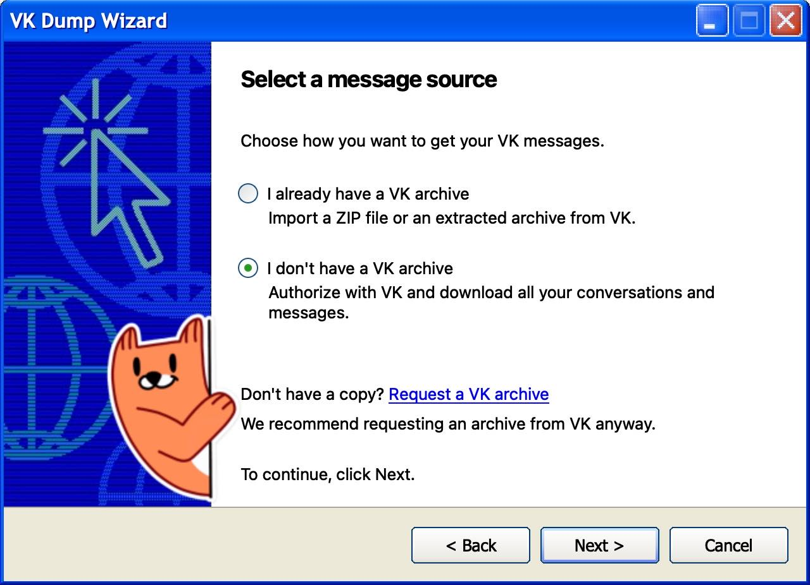

# VKdump

Скачивание и экспорт переписки из VK



## Возможности

- скачивание переписки через VK API или импорт GDPR-архива
- обогащение архива: выкачивание картинок, которые VK оставил ссылками
- докачка доступных пересланных сообщений, ответов и всех вложений через VK API
- экспорт чатов в HTML с картинками
- галерея фотографий по годам и отправителям
- всё то же самое в терминале в cli-версии

## Установка и запуск

### macOS

```sh
brew tap akkez/vkdump https://github.com/akkez/vkdump
brew install --cask akkez/vkdump/vkdump

# GUI
open -a /Applications/VKdump.app

# из терминала
/Applications/VKdump.app/Contents/MacOS/vkdump-cli
```

### Windows и Linux

- скачайте [последний релиз](https://github.com/akkez/vkdump/releases),
- распакуйте и запустите бинарник `vkdump[.exe]`
